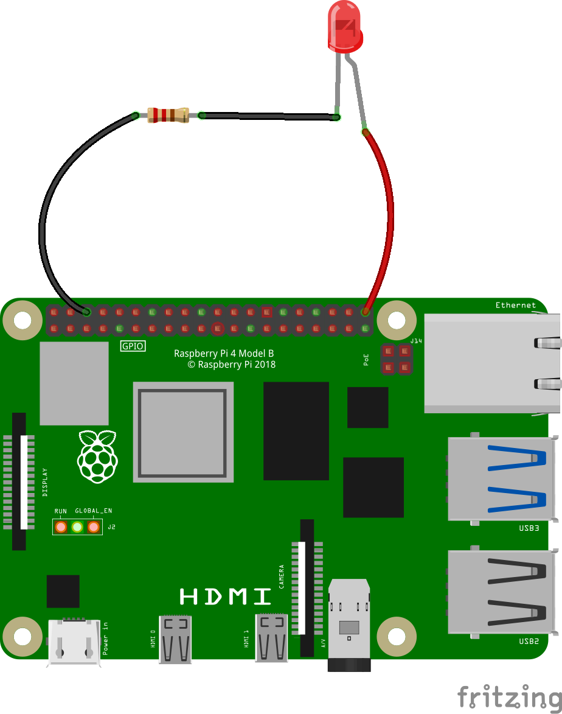
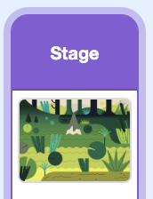

## Code your circuit

Write Scratch code so that your LED lights up when the player is near the hedgehog.

--- task ---

Shut down your Raspberry Pi and disconnect its power before moving the wire. Move the jumper wire from **physical pin 1 (3V3)** to **GPIO21 (physical pin 40)**. Keep the LED and resistor connected in series. Reconnect the power when the wiring is ready.

Use the **GPIO number 21** in Scratch; physical pin 21 is a different pin.



--- /task ---

--- task ---

On the Raspberry Pi, download and open the [starter project](https://rpf.io/p/en/scratch-led-game-get){:target="_blank"}.

--- collapse ---
---
title: Opening a downloaded Scratch 3 Desktop project
---

Once you have downloaded the zip file from the link above, open your file manager and navigate to the **Downloads** folder.

Find the file you just downloaded. It will end in `.zip`.

Right click on the file and choose 'Extract here' to extract them to your downloads folder.

In Scratch 3 Desktop, click the `File` menu and choose `Load from your computer`.

Navigate to your downloads folder again and select the file `scratch-physcomp1.sb3`. 

Click `OK` or press `Enter`.

--- /collapse ---

--- /task ---

--- task ---

Make sure you have the **Stage** selected.



--- /task ---

--- task ---

Using the `Simple Electronics`{:class="block3extensions"} extension from the blocks menu, add the following blocks into the `if`{:class="block3control"} block.

```blocks3
when green flag clicked
forever
if <[0] < (dist) > then
+turn LED (21 v) [on v] ::led extension
else
+turn LED (21 v) [off v] ::led extension
end
```

The starter calculates `dist`{:class="block3variables"} by subtracting the current distance from the previous distance. When the player moves closer to the hedgehog, `dist` is greater than 0, so the LED turns on — `else`{:class="block3control"} it turns off.

--- /task ---

--- task ---

Click on the green flag. Use the arrow keys and the LED to hunt the hedgehog!

--- /task ---

--- save ---
